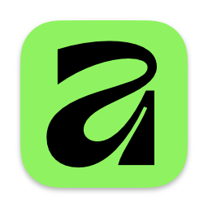

# Affinity Codex Plugin

Connect Codex to Affinity by Canva's native local MCP server for document inspection, vector and photo editing, page layouts, previews, and reusable scripts.

This independent community plugin forwards Affinity's own MCP tools through a local SSE-to-stdio adapter. It includes a workflow skill, a global installer, and a harmless connection check. No cloud server or API key is needed for the local connection.

## Requirements

- macOS with a version of Affinity by Canva that includes the native MCP server, installed and open with that server enabled. Initially tested with Affinity 3.3.0.
- Node.js 20 or newer and npm.
- Python 3 and a recent Codex CLI with `codex plugin add`, available on PATH.
- Codex desktop for the plugin UI.

## Install globally

```sh
git clone https://github.com/ebuberpg-prog/affinity-codex-plugin.git
cd affinity-codex-plugin
npm ci --ignore-scripts
python3 scripts/install-global.py
```

The installer copies the package and dependencies into `~/plugins/affinity`, adds it to the existing personal marketplace at `~/.agents/plugins/marketplace.json`, and installs/enables `affinity@personal`. Other marketplace entries are preserved, and a timestamped catalog backup is saved before updating it. Git history, environment files, and logs are excluded from the installed copy.

Restart Codex and open a new chat. Keep Affinity open and its MCP server enabled. The default port is **6767**.

Try: **“Use Affinity to inspect my open document.”**

## Verify and update

```sh
npm run check
npm run verify
```

Verification performs the native handshake, discovers tools, reads the SDK preamble, and executes only `console.log`. It does not edit documents. The initial tested server exposed 11 tools; the native app controls the available tool set.

For updates:

```sh
git pull --ff-only
npm ci --ignore-scripts
python3 scripts/install-global.py
```

Restart Codex afterward. For local development, edit this checkout, check the connection, and rerun the installer to refresh the global copy. `node_modules` is ignored by Git and installed from the lockfile.

## Connection and workflow

The adapter connects only to `http://127.0.0.1:6767/sse` by default. To use a different app port, pass `AFFINITY_MCP_PORT` in the MCP process environment. For a command-line verification, use `AFFINITY_MCP_PORT=YOUR_PORT npm run verify`.

Tool definitions, messages, results, and application instructions pass through without rewriting them. The skill reads the native SDK preamble before scripting, uses current API documentation, preserves selection when changing spreads, and verifies edits through native previews.

Affinity may restrict SDK filesystem, network, or AI operations in its settings. `NOT_ALLOWED` results should be handled within those restrictions. Its SDK documents filesystem access as limited to Desktop. The plugin does not change application permissions.

The server also exposes optional global hint-search and issue-reporting tools. The skill requires explicit authorization before reporting issues, publishing hints, or sending private document/script content to those services. The local transport itself does not upload documents or transmit telemetry.

## Package contents

- `.codex-plugin/plugin.json`: plugin identity, icon, and skill/MCP declarations.
- `.mcp.json`: local transport launch configuration.
- `scripts/bridge.mjs`: transport adapter using the pinned official MCP SDK.
- `scripts/install-global.py`: personal marketplace installer.
- `scripts/verify.mjs`: non-mutating smoke check.
- `skills/affinity/SKILL.md`: Affinity workflow guidance.

The package follows [OpenAI's plugin format](https://developers.openai.com/plugins/build/plugins). For the native integration, see [Affinity's integrations page](https://www.affinity.studio/integrations). Plugin code and authored documentation are MIT-licensed. The native app icon is excluded; see [NOTICE.md](NOTICE.md).
